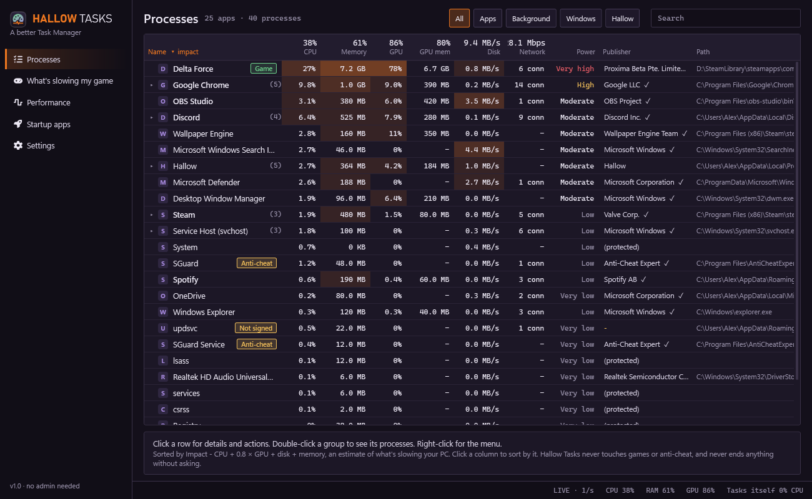

# Hallow Tasks

**A better Task Manager, Hallow style.**

Part of the Hallow family of Windows apps. Hallow Tasks shows what's using your PC, grouped by app, and - while you play -
**what's slowing your game**, with one click to lower it or end it. It never touches the game itself or anti-cheat, never ends
anything without asking, and needs **no admin** for normal use.

## What it does

- **Processes, grouped by app** like Task Manager: Discord, Google Chrome, Steam, OBS... with their child processes inside
  (double-click or the arrow), and every Hallow app under **Hallow**. Helpers of one app (same exe, `conhost`, WebView2, programs in
  the app's own folder) go with it; Windows' own processes are never merged into whoever started them.
  Columns: **CPU %**, **memory** (private working set, like Task Manager), **GPU %** (Windows' "GPU Engine" counters, `engtype_3D`,
  summed per process), **GPU memory** (dedicated), **disk** read + write, **network** (open TCP connections - see the limits below),
  a **power usage hint**, **publisher** (the Authenticode signer, with a tick when the signature is valid; Windows' catalog-signed
  files count) and **path**. Cells are tinted by how busy they are.
- **Sort, search and filter**: the default order is **Impact** = CPU % + 0.8 x GPU % + disk (2 points per MB/s, at most 30) +
  memory (2 points per GB, at most 10) - an estimate of what's slowing your PC. Click a column to sort by it (twice: the other way,
  three times: back to Impact). Search by name, description, publisher, path or PID (Ctrl+F). Filters: All, Apps, Background,
  Windows, Hallow.
- **Details for each process** (click a row, or right-click for the menu): **End task** (a whole app group, or one process) and
  **End process tree**, always with a confirmation (Cancel has the focus). **Set priority** (Idle to High - never Realtime) and
  **set affinity** (with a warning). **Open file location**, **Search online** (opens your browser with a web search, only when you
  click), **Scan with Defender** (through Hallow Guard when it offers a file scan; otherwise Defender's own `MpCmdRun -Scan
  -ScanType 3 -File ... -DisableRemediation`, the engine Guard uses), **Copy details**.
  Windows' core processes (csrss, lsass, svchost, dwm, explorer...), session-0 programs in the Windows folder, your game and
  anti-cheat are **refused with a clear message**.
- **What's slowing my game**: when a game runs - DeltaForceClient-Win64-Shipping.exe, Discovery-d.exe, the exe names you add in
  Settings, or whatever Hallow Hub says you're playing - a panel ranks the other apps by the CPU, GPU and disk they took over the
  last 10 seconds. Each row: **Below normal** or **Idle** for as long as the game runs (put back when the game closes, when you click
  Restore, or when you quit Hallow Tasks - also on update and uninstall), or **End task** (with confirmation).
  The game itself is never listed; **anti-cheat** (SGuard / ACE, EasyAntiCheat, BattlEye, Vanguard, FACEIT, nProtect, XIGNCODE,
  PunkBuster and similar) is listed as **"Anti-cheat - leave alone"** with no buttons, and Windows' own processes as
  "Windows - leave alone".

  
- **Performance**: live graphs of the last 60 seconds - CPU (or **one per core**), GPU (3D, video encode, video decode, copy),
  memory, GPU memory, disk (read / write, active time) and network (send / receive, all adapters) - in the family console style.
  **CPU temperature isn't shown**: Windows only gives it to programs with a kernel driver, and Hallow Tasks (like Hallow Overlay)
  doesn't install one.

  
- **Startup apps** with an impact estimate (Hallow Toolkit's rule: RAM and CPU time per hour it uses now, plus Windows' "slowed
  down startup" events when Windows lets you read them): the Run keys (yours and all users') and the Startup folders, and whether
  Windows' Startup apps page has them switched off. **Your own** entries (HKCU Run) can be **disabled** - moved to Hallow Tasks'
  backup (`HKCU\Software\HallowTasks\DisabledStartup`), with **Restore** (like Hallow Guard). Nothing is deleted; entries for all
  users open Windows' Startup apps page.
- **Hallow family**: the family pipe (`ping`, `status` with the top CPU / GPU users, `open [processes|game|performance|startup|
  settings]`, `menu`, `invoke <id>`, `quit`), `HallowTasks.exe --cmd "<line>"`, `%APPDATA%\HallowTasks\status.json`, Hallow Hub's
  tray menu (Hub 2.13+ lists any app answering `menu`; Tasks hides its own icon only when Hub lists it), the Hallow accent colour
  from `%APPDATA%\Hallow\theme.json`, crash reports kept on this PC, and the GitHub updater (checks the download's SHA-256).
- **Ctrl+Alt+T** opens it - **off by default** (Settings). Ctrl+Shift+Esc belongs to Windows' Task Manager and can't be taken
  over safely.
- **Low overhead**: it samples once a second **only while its window is open and not minimized** (one `NtQuerySystemInformation`
  call for all processes, the GPU counters read in one go, about 10 ms per sample). Closed to the tray it doesn't sample at all.

## Limits (no admin)

- **Per-process network speed** needs admin: Windows only gives bytes per process to ETW tracing (and
  `GetPerTcpConnectionEStats` needs admin to switch its collection on). So the Network column shows each app's **open TCP
  connections**, and the Performance tab the PC's total send / receive speed.
- **Disk** per process is file and device I/O (Windows' I/O counters, like Process Explorer's I/O column); it can include some
  network and device I/O. The Performance tab's disk graph is the physical disks.
- Processes of other users and protected services don't show their path to a normal user; they're marked "(protected)" and
  Hallow Tasks leaves them alone.

## Install

1. Download `Hallow.Tasks.zip` from the [latest release](https://github.com/Dom428/hallow-tasks/releases/latest).
2. Right-click the zip > Properties > tick **Unblock** > OK, then Extract All.
3. Double-click `INSTALL.bat` (no admin needed). It installs to `%LOCALAPPDATA%\Programs\Hallow Tasks` with Start menu and
   Desktop shortcuts and an entry in Windows' Apps list. Settings live in `%APPDATA%\HallowTasks`.

Or install it from [Hallow Setup](https://github.com/Dom428/hallow-setup).

## Build

Built with the C# compiler that ships with Windows (.NET Framework 4.8): run `build.ps1` (`build.ps1 -Tests` also builds
`tests\TasksTests.exe` and `tests\Dummy.exe`). WPF in code, `src\Theme.xaml` embedded - **every colour is a theme brush** there, so
light mode is one more dictionary. `HallowTasks.exe --snap <folder>` renders every page with made-up data.

Tests: grouping, Impact, the protected / anti-cheat / game lists, the game panel, the priority keeper, startup impact and
Disable / Restore on a fake HKCU key, the family pipe of a test copy with made-up processes (a fake process control - nothing real
is ended or changed), read-only sampling of the real PC, and kill / priority / affinity / process tree **only on Dummy.exe
children the tests start themselves**.

## Credits

Icons: [Font Awesome Free](https://fontawesome.com) 7.3.1 by Fonticons, Inc., licensed CC BY 4.0 - see `FontAwesome-LICENSE.txt`.
