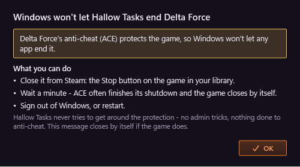
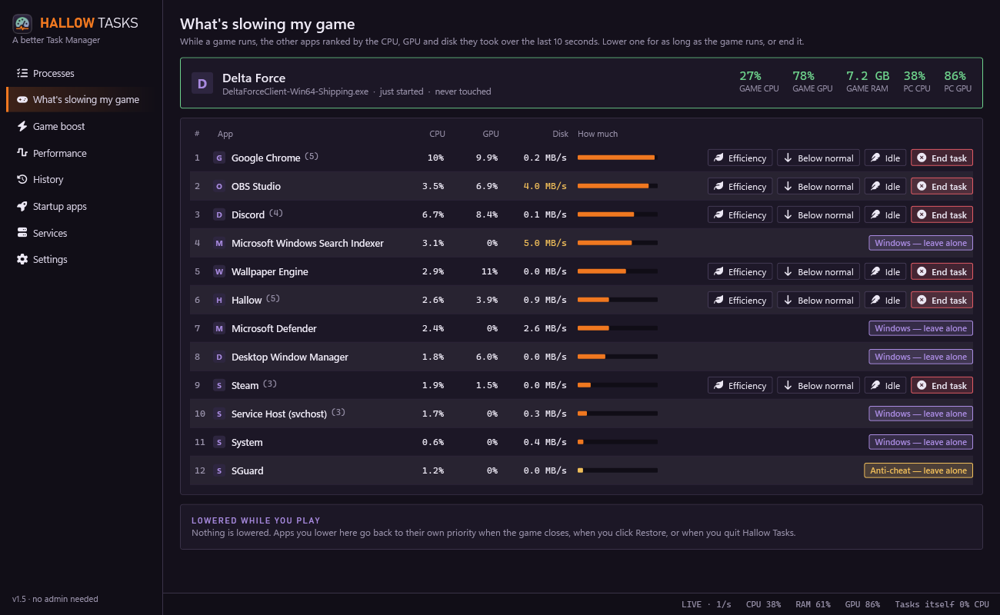
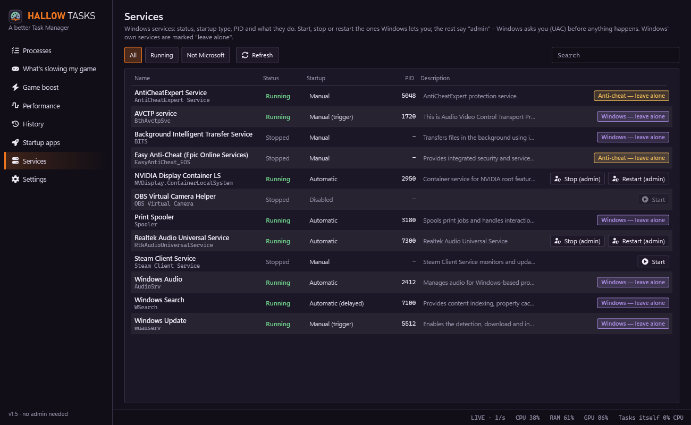
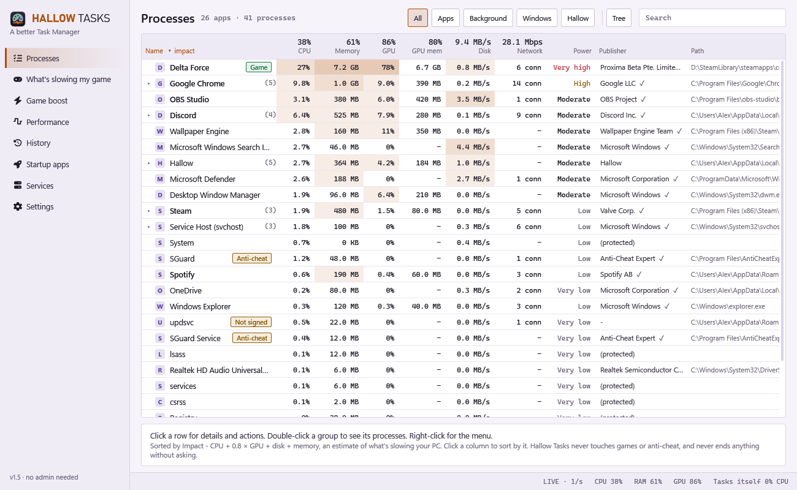

# Hallow Tasks

**A better Task Manager, Hallow style.**

Part of the Hallow family of Windows apps. Hallow Tasks shows what's using your PC, grouped by app, and - while you play -
**what's slowing your game**, with one click to lower it, put it in **Efficiency mode** or end it. **History** shows what spiked
your PC and when, with the stutter moments of your game. It never touches the game by itself and never touches anti-cheat, never
ends anything without asking, and needs **no admin** for normal use. Light and dark mode. 1.3: **Close game...** for a game that
hangs on exit.

## What it does

- **Processes, grouped by app** like Task Manager: Discord, Google Chrome, Steam, OBS... with their child processes inside
  (double-click or the arrow), and every Hallow app under **Hallow**. Helpers of one app (same exe, `conhost`, WebView2, programs in
  the app's own folder) go with it; Windows' own processes are never merged into whoever started them.
  Columns: **CPU %**, **memory** (private working set, like Task Manager), **GPU %** (Windows' "GPU Engine" counters, `engtype_3D`,
  summed per process), **GPU memory** (dedicated), **disk** read + write, **network** (open TCP connections - see the limits below),
  a **power usage hint**, **publisher** (the Authenticode signer, with a tick when the signature is valid; Windows' catalog-signed
  files count) and **path**. Cells are tinted by how busy they are.
- **Sort, search and filter**: the default order is **Impact** = CPU % + 0.8 x GPU % + disk (2 points per MB/s, at most 30) +
  memory (2 points per GB, at most 10) - an estimate of what's slowing your PC. Click a column to sort by it (twice: the other way,
  three times: back to Impact). Search by name, description, publisher, path or PID (Ctrl+F). Filters: All, Apps, Background,
  Windows, Hallow.
- **Details for each process** (click a row, or right-click for the menu): **End task** (a whole app group, or one process) and
  **End process tree**, always with a confirmation (Cancel has the focus). **Set priority** (Idle to High - never Realtime) and
  **set affinity** (with a warning). **Open file location**, **Search online** (opens your browser with a web search, only when you
  click), **Scan with Defender** (through Hallow Guard when it offers a file scan; otherwise Defender's own `MpCmdRun -Scan
  -ScanType 3 -File ... -DisableRemediation`, the engine Guard uses), **Copy details**.
  Windows' core processes (csrss, lsass, svchost, dwm, explorer...), session-0 programs in the Windows folder, your game and
  anti-cheat are **refused with a clear message** (priority, affinity and Efficiency mode stay off for games and anti-cheat).
- **Close game...** (1.3) - for a game that hangs on exit. Only on a process tagged **Game** (never anti-cheat), in the right-click
  menu and the details strip, and only when you click it: a dialog explains both steps first. **Step 1, ask nicely**: Windows asks
  the game's windows to close (`WM_CLOSE`, what Task Manager's End task does for apps), then a 10-second countdown. **Step 2**, only if
  it's still running and you click **Force close**: the game and its own helpers (in its install folder, or its crash / web helpers)
  are ended. Anti-cheat (ACE / SGuard, Easy Anti-Cheat, BattlEye, Vanguard...), Steam, Battle.net and other launchers are never
  touched. If Windows refuses (anti-cheat protects the game), it says so plainly - *"Delta Force's anti-cheat (ACE) protects the
  game, so Windows won't let any app end it"* - and lists what you can do: the Stop button in your Steam library, wait a minute
  (ACE often finishes its shutdown), or sign out / restart. It never tries to get around the protection: no admin, no debug
  privilege, no driver, nothing done to anti-cheat. Nothing is automatic. Tasks' log gets one line: closed nicely, force closed
  or denied.

   

- **What's slowing my game**: when a game runs - DeltaForceClient-Win64-Shipping.exe, Discovery-d.exe, the exe names you add in
  Settings, or whatever Hallow Hub says you're playing - a panel ranks the other apps by the CPU, GPU and disk they took over the
  last 10 seconds. Each row: **Below normal** or **Idle** for as long as the game runs (put back when the game closes, when you click
  Restore, or when you quit Hallow Tasks - also on update and uninstall), or **End task** (with confirmation).
  The game itself is never listed; **anti-cheat** (SGuard / ACE, EasyAntiCheat, BattlEye, Vanguard, FACEIT, nProtect, XIGNCODE,
  PunkBuster and similar) is listed as **"Anti-cheat - leave alone"** with no buttons, and Windows' own processes as
  "Windows - leave alone".

  
- **Performance**: live graphs of the last 60 seconds - CPU (or **one per core**), GPU (3D, video encode, video decode, copy),
  memory, GPU memory, disk (read / write, active time) and network (send / receive, all adapters) - in the family console style.
  **CPU temperature isn't shown**: Windows only gives it to programs with a kernel driver, and Hallow Tasks (like Hallow Overlay)
  doesn't install one.

  
- **History - "what spiked my PC"**: a rolling hour of every app's CPU, GPU, RAM and disk in memory (a point a second while the
  window is open, every 5 s in the tray - Settings can turn the tray part off), plus an optional **24-hour log** on disk
  (`%APPDATA%\HallowTasks\history-24h.jsonl`, one line a minute with that minute's peaks and busiest 8 apps, capped at about
  1 MB; off by default). A **timeline** of the PC's CPU and GPU with the game's time shaded, and a list of **what spiked**: apps
  that took 15%+ CPU, 20%+ GPU or 20+ MB/s of disk, when, for how long and whether you were playing (your game itself isn't
  listed - it's meant to be busy). While a game runs it marks the **stutter moments**: from **Hallow Overlay**'s live numbers
  when Overlay runs (its status `live` - a sudden drop of the 1% low below half its usual value, or a `frameSpikes` counter if
  Overlay offers one), otherwise from CPU / GPU peaks (the PC's CPU at 90%+, or another app suddenly taking 3x what it did the
  minute before). Each one says what else was busy right then.

  
- **Efficiency mode**, the same thing **Windows 11 Task Manager's Efficiency mode** does: Windows' EcoQoS
  (`SetProcessInformation` `ProcessPowerThrottling`, execution speed - it runs on the slower, cooler cores at lower clocks) plus
  Idle priority. No admin needed for your own apps. One click in the game panel, the details strip or the right-click menu; it
  stays until you turn it off or the app closes (like Windows'), and turning it off puts its priority back. **Refused** for
  Windows' own processes, your game and anti-cheat.
- **Services**: every Windows service with its status, startup type (Automatic / delayed / trigger / Manual / Disabled), PID
  and description; search and filter (Running, Not Microsoft). **Start / Stop / Restart** where Windows lets you; otherwise the
  button says **(admin)** and starts a tiny elevated helper (`HallowTasks.exe --svc stop "<name>"`) - **Windows asks you (UAC)
  first**. Microsoft's own services are marked **"Windows - leave alone"** (no buttons) unless you switch that off in Settings;
  anti-cheat's services always are.

  
- **Process tree view** (the **Tree** chip on Processes): every process under the one that started it (a "parent" that
  started later is a reused PID, so that process is a root), with **End tree**.
- **Quiet alerts while you play** (off by default): when a background app takes more than X% CPU or GPU (default 25%) for more
  than N seconds (default 20), a note through **Hallow Hub**'s notification - never a pop-up of Tasks' own over the game. At
  most one per app every 10 minutes; without Hub they only appear in History.
- **Precise network (needs admin)**, optional: Settings starts a small helper - Hallow Tasks itself with `--netetw` -
  **elevated after Windows asks you (UAC)**. It runs one real-time ETW session on Microsoft-Windows-Kernel-Network (TCP / UDP
  sent and received, IPv4 and IPv6) and reads only each event's process id and byte count - never addresses or contents - and
  sends per-process bytes per second over a local pipe only you can open. The Network column then shows send + receive speed.
  It stops when you switch it off or close Hallow Tasks, and never starts by itself.
- **Light and dark mode** (the Hallow family spec): follows `"mode"` in `%APPDATA%\Hallow\theme.json` (dark / light / "Same as
  Windows") live, with **Settings > Look: Follow Hallow / Light / Dark** for Tasks alone. Light uses the family palette; the
  accent is darkened for text until it reads at 4.5:1, status text uses the text-safe green / amber / red, and Windows' title bar
  follows.

  
- **Startup apps** with an impact estimate (Hallow Toolkit's rule: RAM and CPU time per hour it uses now, plus Windows' "slowed
  down startup" events when Windows lets you read them): the Run keys (yours and all users') and the Startup folders, and whether
  Windows' Startup apps page has them switched off. **Your own** entries (HKCU Run) can be **disabled** - moved to Hallow Tasks'
  backup (`HKCU\Software\HallowTasks\DisabledStartup`), with **Restore** (like Hallow Guard). Nothing is deleted; entries for all
  users open Windows' Startup apps page.
- **Hallow family**: the family pipe (`ping`, `status` with the top CPU / GPU users, `quick` (1.2: the same fields at once, from a
  cached sample never more than 5 s old - for Hallow Remote and Hub), `open [processes|game|performance|startup|
  settings|history|services]`, `menu`, `invoke <id>`, `quit`), `HallowTasks.exe --cmd "<line>"`, `%APPDATA%\HallowTasks\status.json`, Hallow Hub's
  tray menu (Hub 2.13+ lists any app answering `menu`; Tasks hides its own icon only when Hub lists it), the Hallow accent colour
  from `%APPDATA%\Hallow\theme.json`, crash reports kept on this PC, and the GitHub updater (checks the download's SHA-256). Status carries `busyApps` (1.2: how many apps
  use at least `busyPercent` = 5% of the CPU or GPU - a count, no names). While Hub or Remote runs, or someone asked `quick` in the last
  2 minutes, status.json is rewritten with every sample (about every 5 s); otherwise every 60 s.
- **Ctrl+Alt+T** opens it - **off by default** (Settings). Ctrl+Shift+Esc belongs to Windows' Task Manager and can't be taken
  over safely.
- **Low overhead**: once a second while its window is open and not minimized (one `NtQuerySystemInformation` call for all
  processes, the GPU counters read in one go, about 10 ms per sample); every 5 s in the tray for History (or not at all, if you
  switch that off). Measured on a 32-thread PC: **0.02% of the CPU in the tray, 0.05% with the window open**. 1.2, with Hallow
  Remote / Hub asking every 3 s: 0.018% with `quick`, 0.028% with `status` (1.1: 0.050%); idle in the tray unchanged (0.012-0.016%).

## Limits (no admin)

- **Per-process network speed** needs admin: Windows only gives bytes per process to ETW tracing. Without "Precise network" the
  Network column shows each app's **open TCP connections**, and the Performance tab the PC's total send / receive speed.
- **Services** you may not control (most of them) need admin to start or stop - that's what the (admin) buttons and UAC are for.
- **Disk** per process is file and device I/O (Windows' I/O counters, like Process Explorer's I/O column); it can include some
  network and device I/O. The Performance tab's disk graph is the physical disks.
- Processes of other users and protected services don't show their path to a normal user; they're marked "(protected)" and
  Hallow Tasks leaves them alone.

## Install

1. Download `Hallow.Tasks.zip` from the [latest release](https://github.com/Dom428/hallow-tasks/releases/latest).
2. Right-click the zip > Properties > tick **Unblock** > OK, then Extract All.
3. Double-click `INSTALL.bat` (no admin needed). It installs to `%LOCALAPPDATA%\Programs\Hallow Tasks` with Start menu and
   Desktop shortcuts and an entry in Windows' Apps list. Settings live in `%APPDATA%\HallowTasks`.

Or install it from [Hallow Setup](https://github.com/Dom428/hallow-setup).

## Build

Built with the C# compiler that ships with Windows (.NET Framework 4.8): run `build.ps1` (`build.ps1 -Tests` also builds
`tests\TasksTests.exe` and `tests\Dummy.exe`). WPF in code, `src\Theme.xaml` embedded - **every colour is a theme brush** there, so
light mode swaps the values of the same keys (`src\Look.cs`). `HallowTasks.exe --snap <folder>` renders every page in dark and light with made-up data.

Tests: grouping, Impact, the protected / anti-cheat / game lists, the game panel, the priority keeper, startup impact and
Disable / Restore on a fake HKCU key, the family pipe of a test copy with made-up processes (a fake process control - nothing real
is ended or changed), read-only sampling of the real PC, and kill / priority / affinity / process tree / Efficiency mode **only
on Dummy.exe children the tests start themselves**. 1.1 adds: mode resolution (missing = dark, system through a fake, the per-app
Look wins) and a contrast check of every light text / background pair with several accents (>= 4.5:1, 3:1 for graph lines);
History spikes, stutters (CPU peaks and Overlay's live numbers), the 24-hour log and its cap; alerts; the tree; services with a
**fake controller** (the real list is only read - no service is ever started or stopped in tests, and no UAC prompt is ever
shown); the precise-network protocol, a made-up kernel event, and the helper started **without** elevation (it must answer
"denied"); and the overhead of a real test copy in the tray and with its window "open". 1.2 adds: the busy-app count, `quick`
(fresh within 5 s over 14 s, answered from the cache, also with the real sampler), status.json kept fresh while asked, and no History
from samples taken only for Remote / Hub; 1.2.1: right after start `quick` never answers with the first sample's zeros. 1.3: Close game - who it's offered for (never anti-cheat or launchers, even listed as games), what Force close may end, the steps with a fake process layer (closed nicely, forced, access denied, the log), and **stand-ins the tests start in their own temp folder** (tests\StandIn.exe: an off-screen window that closes on WM_CLOSE or ignores it, with a helper, an anti-cheat-named and a launcher-named child that must stay untouched). The suite stops itself (and the ship script kills it) after 5 minutes.

## Credits

Icons: [Font Awesome Free](https://fontawesome.com) 7.3.1 by Fonticons, Inc., licensed CC BY 4.0 - see `FontAwesome-LICENSE.txt`.
